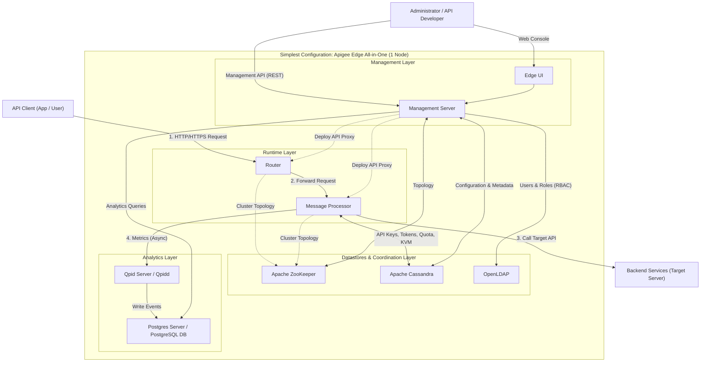
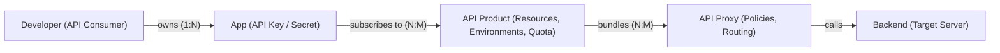

# Apigee Edge — How It Works, Components, and Architecture

**Apigee Edge** is an API Management Platform that operates as an intermediary layer (**API Proxy / Reverse Proxy**) between client applications (API consumers) and backend services.

---

## 1. How Does Apigee Edge Work?

Apigee Edge architecture separates API traffic processing from platform management into two main planes:

* **Runtime / Data Plane:** handles actual API traffic in real time. No client request goes directly to the backend — every request passes through an **API Proxy**.
* **Management / Control Plane:** used for creating, configuring, and deploying API Proxies, managing developers, apps, and API products, as well as viewing analytics reports.

### Flow of a Single API Request

1. A **Client** sends an HTTP/HTTPS request to an address exposed by Apigee (Virtual Host).
2. The **Router** terminates the TLS connection, matches the request to the appropriate environment, and forwards it to an available **Message Processor** (acting as an internal load balancer).
3. The **Message Processor (MP)** executes the **Policies** configured in the API Proxy for the *Request Flow*, such as:
   * authentication and authorization (API Key, OAuth 2.0, JWT),
   * traffic protection (Quota, Spike Arrest),
   * payload transformations (XML ↔ JSON), validation, and caching.
   During processing, it queries **Cassandra** (e.g., to verify tokens or quota counters).
4. The **Message Processor** forwards the modified request to the target **backend** (*Target Endpoint*).
5. Upon receiving the response from the backend, the **MP** executes the *Response Flow* policies and returns the response through the **Router** to the client.
6. **Asynchronously** (without delaying the response to the client), the **MP** sends telemetry and traffic metrics to the analytics layer (**Qpid → PostgreSQL**).

---

## 2. Core Components of Apigee Edge

In the classic **Apigee Edge (Private Cloud / OPDK)** architecture, the platform consists of the following components organized into 4 layers:

### Runtime Layer
* **Router** – the entry point for all API traffic; handles Virtual Hosts, TLS certificates, and load-balances traffic across Message Processors.
* **Message Processor (MP)** – the execution engine that processes requests/responses, executes API Proxy policies, communicates with the backend, and collects analytics data.

### Management Layer
* **Management Server** – exposes the REST Management API; coordinates API Proxy deployments, organization and environment configuration, and retrieves data for reports.
* **Edge UI** – web interface for administrators and API developers (communicates exclusively with the Management Server).

### Datastores & Coordination Layer
* **Apache Cassandra** – distributed NoSQL database storing API Proxy configurations, app and developer data, API keys, OAuth tokens, Quota counters, and KVMs (Key Value Maps).
* **Apache ZooKeeper** – stores cluster topology (nodes, pods, regions) and enables components to discover one another (*service discovery*).
* **OpenLDAP** – directory of Apigee Edge platform users (administrators and UI users), roles, and permissions (RBAC).

### Analytics Layer
* **Qpid Server + Qpid Daemon (`qpidd`)** – message queue broker that buffers and pre-processes raw analytics events sent by Message Processors.
* **Postgres Server + PostgreSQL DB** – relational database storing aggregated analytics data along with the server handling report queries from Edge UI / Management API.

*(Optionally, the platform can be extended with a **Developer Portal** for API consumers and a **Monetization** module.)*

---

## 3. Architecture Diagram of the Simplest Configuration

The simplest official Apigee Edge topology is **All-in-One (AIO)** — all components run on a **single node (1 server/VM)**. This configuration is intended strictly for development, testing, and PoC environments.

> **Production Note:** The **All-in-One** configuration does not provide high availability (HA). In production environments, components are distributed across multiple nodes (standard topologies include a **5-node** minimal cluster or **9 / 12 / 13-node** topologies with a 3-node Cassandra/ZooKeeper cluster, a Router+MP pair behind an external Load Balancer, and a Master–Standby pair for PostgreSQL and Qpid).

---

## 4. Access Control Model: Developer, App, and API Product

In Apigee, **Developer**, **App**, and **API Product** form the access control (and analytics) model for your API consumers. In Apigee, **apps are never granted direct access to an API Proxy** — access is always granted through an API Product.

### Developer
* **Who they are:** a consumer of your APIs — an individual (or team/partner account) who builds client applications using the exposed services. *(Not to be confused with an administrator or API Proxy creator working in Edge UI).*
* **What it contains:** identified by a unique email address, has a status (`active` / `inactive`), and optional *Custom Attributes*.
* **Role:** owns one or more **Apps**. Deactivating a developer blocks traffic from all of their apps.

### API Product
* **What it is:** a logical business-and-technical bundle serving as the **unit of access control and API packaging**.
* **What it defines:**
  * **Resource scope:** which **API Proxies** and specific resource paths/HTTP methods are included in the bundle (e.g., `GET /products/**` only),
  * **Environments:** where the product is active (e.g., `test`, `prod`),
  * **Quota limits:** e.g., 100 requests/min (later read by the *Quota* policy in the proxy),
  * **Approval type:** automatic (*Auto*) or manual (*Manual*) for new apps,
  * **OAuth Scopes** and **custom attributes** (e.g., pricing tier: `Free` / `Gold`).
* **Role:** enables you to expose or monetize the same API Proxy in different ways without duplicating proxy code (e.g., `Orders-Free` with read-only access and a low quota, and `Orders-Premium` with full CRUD and a high quota).

### App (Developer App)
* **What it is:** a representation of a specific client (e.g., an iOS mobile app, a B2B partner portal, a microservice) that calls your APIs.
* **What it contains:**
  * a link to its owner (**Developer**),
  * a list of subscribed **API Products** (each with a status such as `approved` / `revoked`),
  * credentials generated by Apigee (**Credentials**): **Consumer Key (API Key / Client ID)** and **Consumer Secret (Client Secret)**,
  * an optional `Callback URL` (for OAuth 2.0 flows) and custom attributes.
* **Role:** the client sends the App's credentials in API requests (directly as an API Key or to obtain an OAuth 2.0 token).

### Relationships Between Concepts

### How Does It Work at Runtime?
1. The client sends a request to an **API Proxy**, attaching its **App's** API key (or OAuth token).
2. A policy in the API Proxy (`VerifyAPIKey` or `OAuthV2`) verifies the credentials against Cassandra:
   * whether both the **App** and its **Developer** are active,
   * whether the App has approved access to an **API Product** covering the requested proxy, resource path, and environment.
3. Upon successful verification, Apigee populates flow variables with metadata from the Developer, App, and API Product (such as the Product's Quota limit) and records in **Analytics** exactly which developer, through which app, and under which product made the call.
