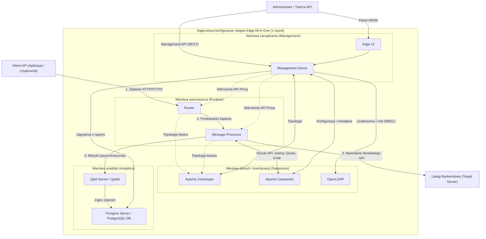

# Apigee Edge — zasada działania, komponenty i architektura

**Apigee Edge** to platforma do zarządzania API (API Management Platform), która działa jako warstwa pośrednicząca (**API Proxy / Reverse Proxy**) pomiędzy aplikacjami klienckimi (konsumentami API) a usługami backendowymi.

---

## 1. Jak działa Apigee Edge?

Architektura Apigee Edge rozdziela przetwarzanie ruchu API od zarządzania platformą na dwie główne płaszczyzny:

* **Płaszczyzna wykonawcza (Runtime / Data Plane):** obsługuje właściwy ruch API w czasie rzeczywistym. Żadne żądanie klienta nie trafia bezpośrednio do backendu — przechodzi przez **API Proxy**.
* **Płaszczyzna zarządzania (Management / Control Plane):** służy do tworzenia, konfigurowania i wdrażania API Proxy, zarządzania deweloperami, aplikacjami, produktami API oraz przeglądania raportów analitycznych.

### Przepływ pojedynczego żądania API

1. **Klient** wysyła żądanie HTTP/HTTPS na adres wystawiony przez Apigee (Virtual Host).
2. **Router** terminuje połączenie TLS, dopasowuje żądanie do odpowiedniego środowiska i kieruje je do dostępnego **Message Processora** (pełni rolę wewnętrznego load balancera).
3. **Message Processor (MP)** wykonuje zdefiniowane w API Proxy polityki (*Policies*) dla przepływu wejściowego (*Request Flow*), np.:
   * uwierzytelnianie i autoryzację (API Key, OAuth 2.0, JWT),
   * ochronę przed przeciążeniem (Quota, Spike Arrest),
   * transformacje payloadu (XML ↔ JSON), walidację i caching.
   W trakcie przetwarzania korzysta z bazy **Cassandra** (np. do weryfikacji tokenów lub liczników limitów).
4. **Message Processor** przekazuje zmodyfikowane żądanie do właściwego **backendu** (*Target Endpoint*).
5. Po otrzymaniu odpowiedzi z backendu **MP** wykonuje polityki wyjściowe (*Response Flow*), a następnie zwraca odpowiedź przez **Router** do klienta.
6. **Asynchronicznie** (bez opóźniania odpowiedzi dla klienta) **MP** wysyła telemetrię i metryki ruchu do warstwy analitycznej (**Qpid → PostgreSQL**).

---

## 2. Komponenty składowe Apigee Edge

W klasycznej architekturze **Apigee Edge (Private Cloud / OPDK)** platforma składa się z następujących komponentów podzielonych na 4 warstwy:

### Warstwa wykonawcza (Runtime)
* **Router** – punkt wejścia dla całego ruchu API; obsługuje Virtual Hosty, certyfikaty TLS i rozdziela ruch pomiędzy Message Processory.
* **Message Processor (MP)** – silnik wykonawczy przetwarzający żądania/odpowiedzi, wykonujący polityki API Proxy, komunikujący się z backendem oraz zbierający dane analityczne.

### Warstwa zarządzania (Management)
* **Management Server** – udostępnia REST-owe Management API; koordynuje wdrażanie API Proxy, konfigurację organizacji i środowisk oraz pobiera dane do raportów.
* **Edge UI** – interfejs webowy dla administratorów i twórców API (komunikuje się wyłącznie z Management Serverem).

### Warstwa danych i koordynacji (Datastores)
* **Apache Cassandra** – rozproszona baza NoSQL przechowująca konfiguracje API Proxy, dane aplikacji i deweloperów, klucze API, tokeny OAuth, liczniki Quota oraz KVM (Key Value Maps).
* **Apache ZooKeeper** – przechowuje topologię klastra (węzły, pody, regiony) i umożliwia komponentom wzajemne odnajdywanie się (*service discovery*).
* **OpenLDAP** – katalog użytkowników platformy Apigee Edge (administratorów i użytkowników panelu), ról oraz uprawnień (RBAC).

### Warstwa analityki (Analytics)
* **Qpid Server + Qpid Daemon (`qpidd`)** – broker kolejki komunikatów, który buforuje i wstępnie przetwarza surowe zdarzenia analityczne wysyłane przez Message Processory.
* **Postgres Server + PostgreSQL DB** – baza relacyjna przechowująca zagregowane dane analityczne oraz serwer obsługujący zapytania raportowe z Edge UI / Management API.

*(Opcjonalnie platformę można rozszerzyć m.in. o **Developer Portal** dla konsumentów API oraz moduł **Monetization**).*

---

## 3. Diagram architektury najprostszej konfiguracji

Najprostsza oficjalna topologia Apigee Edge to **All-in-One (AIO)** — wszystkie komponenty działają na **jednym węźle (1 serwer/VM)**. Taka konfiguracja służy wyłącznie do środowisk deweloperskich, testowych i PoC.

> **Uwaga produkcyjna:** Konfiguracja **All-in-One** nie zapewnia wysokiej dostępności (HA). W środowiskach produkcyjnych komponenty rozdziela się na wiele węzłów (standardowe topologie to np. **5-węzłowa** dla minimalnego klastra lub **9 / 12 / 13-węzłowa** z klastrem 3x Cassandra/ZooKeeper, parą Router+MP za zewnętrznym Load Balancerem oraz parą Master–Standby dla PostgreSQL i Qpid).
