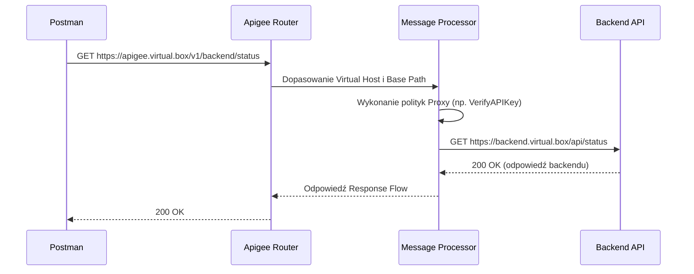

# Prosty przepływ w Apigee Edge: Postman → Apigee → Backend

Poniższa instrukcja opisuje krok po kroku, jak skonfigurować prosty przepływ ruchu API z aplikacji **Postman** do backendu przez **Apigee Edge**.

### Przyjęte adresy
* **Apigee Edge (punkt wejścia / Virtual Host):** `https://apigee.virtual.box`
* **Backend (Target Server):** `https://backend.virtual.box/api`
* **Przykładowy Base Path w Apigee:** `/v1/backend`
* **Docelowy adres wywoływany z Postmana:** `https://apigee.virtual.box/v1/backend/<zasób>`  
  *(Apigee przekaże żądanie na `https://backend.virtual.box/api/<zasób>`)*



---

## Wymagania wstępne (Prerequisites)

Zanim zaczniesz tworzyć API Proxy, upewnij się, że:

1. **Sieć i DNS (szczególnie w środowisku VirtualBox):**
   * Maszyna z **Postmanem** rozwiązuje nazwę `apigee.virtual.box` (np. wpis w `/etc/hosts` lub lokalny DNS) i ma dostęp do portu `443`.
   * Maszyna z **Apigee Message Processorem** rozwiązuje nazwę `backend.virtual.box` i może połączyć się z `https://backend.virtual.box/api` (warto sprawdzić z terminala serwera MP poleceniem `curl -v https://backend.virtual.box/api`).
2. **Virtual Host w Apigee Edge:**
   * W **Edge UI** w sekcji `Admin → Environments → Virtual Hosts` istnieje Virtual Host HTTPS (zazwyczaj o nazwie `secure`) z ustawionym aliasem `apigee.virtual.box` oraz portem `443` i podpiętym Keystore z certyfikatem TLS.
3. **Certyfikat TLS backendu (jeśli `backend.virtual.box` używa certyfikatu self-signed):**
   * Ponieważ połączenie z Apigee do backendu odbywa się po **HTTPS**, Message Processor musi ufać certyfikatowi serwera `backend.virtual.box`.
   * W **Edge UI** przejdź do `Admin → Environments → TLS Keystores`, utwórz **Truststore** (np. `backend-truststore`), wgraj certyfikat CA (lub samopodpisany certyfikat `backend.virtual.box`), a następnie utwórz dla niego referencję w `Admin → Environments → References` (np. `backend-truststore-ref`).

---

## Część A: Najprostszy przepływ (Pass-Through — bez autoryzacji)

### Krok 1: Utworzenie API Proxy w Edge UI

1. Zaloguj się do **Apigee Edge UI**.
2. W menu po lewej stronie wybierz **Develop → API Proxies**, a następnie kliknij **+ Proxy**.
3. Wybierz typ **Reverse Proxy (most common)** i kliknij **Next**.
4. Uzupełnij sekcję **Proxy Details**:
   * **Proxy Name:** `backend-simple-proxy`
   * **Proxy Base Path:** `/v1/backend`
   * **Target (Existing API):** `https://backend.virtual.box/api`
   * Kliknij **Next**.
5. W sekcji **Common Policies** wybierz **Pass through (none)** i kliknij **Next**.
6. W sekcji **Virtual Hosts** zaznacz `secure` (HTTPS — odpowiadający za `https://apigee.virtual.box`) i kliknij **Next**.
7. W sekcji **Summary** wybierz docelowe środowisko wdrożenia (np. `test` lub `prod`) i kliknij **Create and Deploy**.
8. Po zakończeniu wdrażania kliknij **Edit proxy** (lub otwórz proxy z listy).

### Krok 2: Konfiguracja Truststore dla backendu (tylko dla certyfikatów self-signed)

Jeśli `backend.virtual.box` posiada certyfikat podpisany przez prywatne CA lub self-signed, w zakładce **Develop** otwórz `Target Endpoints → default` i zaktualizuj sekcję `<HTTPTargetConnection>`:

```xml
<HTTPTargetConnection>
    <URL>https://backend.virtual.box/api</URL>
    <SSLInfo>
        <Enabled>true</Enabled>
        <TrustStore>ref://backend-truststore-ref</TrustStore>
    </SSLInfo>
</HTTPTargetConnection>
```

Zapisz zmiany (**Save**) i upewnij się, że rewizja jest wdrożona (**Deployment**).

### Krok 3: Uruchomienie sesji Trace (debugowanie w Apigee)

1. W widoku `backend-simple-proxy` przejdź do zakładki **Trace** (lub **Debug**).
2. Wybierz środowisko, na którym wdrożyłeś proxy, i kliknij **Start Trace Session**.

### Krok 4: Wysłanie żądania z Postmana

1. Otwórz **Postman** i utwórz nowe żądanie:
   * **Metoda:** `GET` (lub inna obsługiwana przez Twój backend)
   * **URL:** `https://apigee.virtual.box/v1/backend/<ścieżka-zasobu>`  
     *(np. `https://apigee.virtual.box/v1/backend/health` trafi na `https://backend.virtual.box/api/health`)*
2. *(Tylko w środowisku testowym z certyfikatem self-signed)* Jeśli `apigee.virtual.box` używa samopodpisanego certyfikatu, w Postmanie przejdź do **Settings → General** i wyłącz opcję **SSL certificate verification** (albo zaimportuj certyfikat CA w **Settings → Certificates**).
3. Kliknij **Send**.
4. Zweryfikuj:
   * W **Postmanie** powinieneś otrzymać odpowiedź z backendu (np. `200 OK`).
   * W zakładce **Trace** w Apigee Edge UI zobaczysz pełną ścieżkę żądania, w tym wywołanie docelowe `https://backend.virtual.box/api/...` oraz czas przetwarzania w Apigee i po stronie backendu.

---

## Część B: Zabezpieczenie przepływu kluczem API (zalecane)

Aby wykorzystać pełny model kontroli dostępu Apigee (**API Product → Developer → App**), dodaj weryfikację klucza API.

### Krok 1: Dodanie polityki `Verify API Key` do Proxy

1. Otwórz `backend-simple-proxy` i przejdź do zakładki **Develop**.
2. W panelu **Navigator** kliknij `Proxy Endpoints → default → PreFlow`.
3. W górnej części diagramu (Request) kliknij **+ Step**, wybierz politykę **Verify API Key**, nazwij ją np. `Verify-API-Key` i kliknij **Add**.
4. Zmień konfigurację XML polityki, aby odczytywała klucz z nagłówka HTTP `x-api-key`:

```xml
<VerifyAPIKey name="Verify-API-Key">
    <APIKey ref="request.header.x-api-key"/>
</VerifyAPIKey>
```

5. *(Dobra praktyka)* Dodaj kolejny krok po `Verify-API-Key` — politykę **Assign Message** (np. `AM-Remove-ApiKey`), aby nie przekazywać klucza Apigee dalej do backendu:

```xml
<AssignMessage name="AM-Remove-ApiKey">
    <Remove>
        <Headers>
            <Header name="x-api-key"/>
        </Headers>
    </Remove>
    <IgnoreUnresolvedVariables>true</IgnoreUnresolvedVariables>
</AssignMessage>
```

6. Kliknij **Save** (zapisz jako nową rewizję, jeśli bieżąca jest zablokowana) i wdróż ją na środowisko.

### Krok 2: Utworzenie Produktu API (API Product)

1. Przejdź do **Publish → API Products** i kliknij **+ API Product**.
2. Uzupełnij pola:
   * **Name:** `Backend-Simple-Product`
   * **Display Name:** `Backend Simple Product`
   * **Environment:** zaznacz środowisko wdrożenia (np. `test` / `prod`)
   * **Access:** `Public` (lub `Private`)
   * **API Proxies:** dodaj `backend-simple-proxy`
3. Kliknij **Save**.

### Krok 3: Utworzenie Dewelopera (Developer)

1. Przejdź do **Publish → Developers** i kliknij **+ Developer**.
2. Wpisz imię, nazwisko, nazwę użytkownika oraz adres e-mail (np. `tester@virtual.box`).
3. Kliknij **Create**.

### Krok 4: Utworzenie Aplikacji (App) i pobranie klucza API

1. Przejdź do **Publish → Apps** i kliknij **+ App**.
2. Uzupełnij pola:
   * **Name:** `Postman-Client-App`
   * **Developer:** wybierz utworzonego dewelopera (`tester@virtual.box`)
   * **Products:** dodaj `Backend-Simple-Product`
3. Kliknij **Create**.
4. Na stronie szczegółów aplikacji w sekcji **Credentials** kliknij **Show** przy polu **Key (Consumer Key)** i skopiuj wartość klucza.

### Krok 5: Weryfikacja w Postmanie

1. **Test negatywny (bez klucza):** wyślij żądanie `GET https://apigee.virtual.box/v1/backend/<zasób>` bez nagłówka `x-api-key`.
   * Oczekiwany wynik: `401 Unauthorized` (Apigee odrzuca żądanie zanim trafi do backendu).
2. **Test pozytywny (z kluczem):** w zakładce **Headers** w Postmanie dodaj nagłówek:
   * **Key:** `x-api-key`
   * **Value:** `<skopiowany Consumer Key>`
   * Wyślij żądanie ponownie.
   * Oczekiwany wynik: `200 OK` oraz odpowiedź zwrócona z `https://backend.virtual.box/api/<zasób>`.

---

## Rozwiązywanie najczęstszych problemów

| Objaw | Najczęstsza przyczyna | Rozwiązanie |
| :--- | :--- | :--- |
| Błąd SSL w Postmanie (`SELF_SIGNED_CERT_IN_CHAIN`) | Certyfikat `apigee.virtual.box` jest samopodpisany | Wyłącz *SSL certificate verification* w ustawieniach Postmana (tylko do testów) lub dodaj certyfikat CA do Postmana |
| `404 Not Found` z Apigee (komunikat `Unable to identify proxy for host`) | Niezgodny Virtual Host, zły Base Path lub proxy nie jest wdrożone | Sprawdź w `Virtual Hosts` alias `apigee.virtual.box`, zweryfikuj Base Path (`/v1/backend`) oraz status wdrożenia proxy |
| `503 Service Unavailable` / błąd TLS handshake w Trace | Message Processor nie ufa certyfikatowi `backend.virtual.box` lub nie rozwiązuje jego nazwy DNS | Sprawdź `curl -v https://backend.virtual.box/api` z maszyny MP oraz konfigurację `<SSLInfo>` i Truststore |
| `401 Unauthorized` mimo wysłania klucza | Nazwa nagłówka nie zgadza się z `VerifyAPIKey`, brak powiązania proxy z Produktem lub zły status Aplikacji | Zweryfikuj nagłówek `x-api-key`, środowisko w Produkcie API oraz status `Approved` w Aplikacji |
