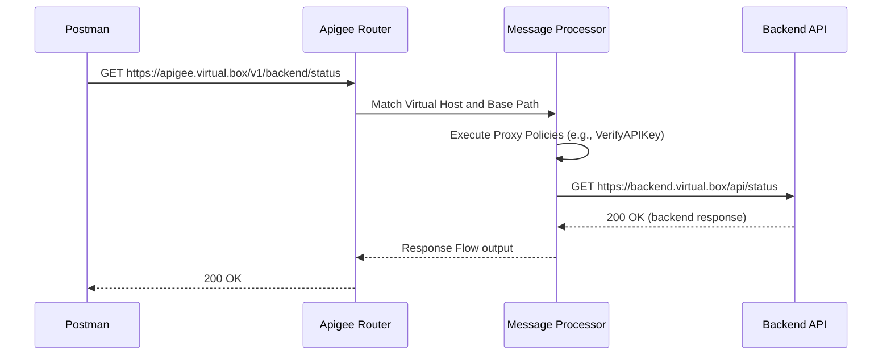

# Simple Flow in Apigee Edge: Postman → Apigee → Backend

This guide provides step-by-step instructions for setting up a simple API traffic flow from **Postman** to a backend service through **Apigee Edge**.

### Assumed Addresses
* **Apigee Edge (Entry Point / Virtual Host):** `https://apigee.virtual.box`
* **Backend (Target Server):** `https://backend.virtual.box/api`
* **Example Base Path in Apigee:** `/v1/backend`
* **Target URL called from Postman:** `https://apigee.virtual.box/v1/backend/<resource>`  
  *(Apigee forwards the request to `https://backend.virtual.box/api/<resource>`)*



---

## Prerequisites

Before you start creating an API Proxy, make sure that:

1. **Networking and DNS (especially in a VirtualBox lab):**
   * The machine running **Postman** resolves `apigee.virtual.box` (e.g., via `/etc/hosts` or local DNS) and can reach port `443`.
   * The machine running the **Apigee Message Processor** resolves `backend.virtual.box` and can connect to `https://backend.virtual.box/api` (verify from the MP server terminal using `curl -v https://backend.virtual.box/api`).
2. **Virtual Host in Apigee Edge:**
   * In **Edge UI**, under `Admin → Environments → Virtual Hosts`, there is an HTTPS Virtual Host (typically named `secure`) with the host alias `apigee.virtual.box`, port `443`, and a configured TLS Keystore.
3. **Backend TLS Certificate (if `backend.virtual.box` uses a self-signed certificate):**
   * Because the connection from Apigee to the backend uses **HTTPS**, the Message Processor must trust the certificate presented by `backend.virtual.box`.
   * In **Edge UI**, go to `Admin → Environments → TLS Keystores`, create a **Truststore** (e.g., `backend-truststore`), upload the CA certificate (or the self-signed certificate of `backend.virtual.box`), and create a reference to it under `Admin → Environments → References` (e.g., `backend-truststore-ref`).

---

## Part A: Simplest Flow (Pass-Through — No Authentication)

### Step 1: Create an API Proxy in Edge UI

1. Log in to **Apigee Edge UI**.
2. In the left navigation menu, go to **Develop → API Proxies**, then click **+ Proxy**.
3. Select **Reverse Proxy (most common)** and click **Next**.
4. Fill in **Proxy Details**:
   * **Proxy Name:** `backend-simple-proxy`
   * **Proxy Base Path:** `/v1/backend`
   * **Target (Existing API):** `https://backend.virtual.box/api`
   * Click **Next**.
5. Under **Common Policies**, select **Pass through (none)** and click **Next**.
6. Under **Virtual Hosts**, select `secure` (HTTPS — corresponding to `https://apigee.virtual.box`) and click **Next**.
7. On the **Summary** screen, select your target deployment environment (e.g., `test` or `prod`) and click **Create and Deploy**.
8. Once deployment completes, click **Edit proxy** (or open the proxy from the list).

### Step 2: Configure the Backend Truststore (Only for Self-Signed Certificates)

If `backend.virtual.box` uses a self-signed certificate or one signed by a private CA, open `Target Endpoints → default` in the **Develop** tab and update `<HTTPTargetConnection>`:

```xml
<HTTPTargetConnection>
    <URL>https://backend.virtual.box/api</URL>
    <SSLInfo>
        <Enabled>true</Enabled>
        <TrustStore>ref://backend-truststore-ref</TrustStore>
    </SSLInfo>
</HTTPTargetConnection>
```

Save your changes (**Save**) and make sure the revision is deployed (**Deployment**).

### Step 3: Start a Trace Session (Debugging in Apigee)

1. In the `backend-simple-proxy` view, switch to the **Trace** (or **Debug**) tab.
2. Select the environment where your proxy is deployed and click **Start Trace Session**.

### Step 4: Send a Request from Postman

1. Open **Postman** and create a new request:
   * **Method:** `GET` (or another method supported by your backend)
   * **URL:** `https://apigee.virtual.box/v1/backend/<resource-path>`  
     *(e.g., `https://apigee.virtual.box/v1/backend/health` will forward to `https://backend.virtual.box/api/health`)*
2. *(Test environments with self-signed certificates only)* If `apigee.virtual.box` uses a self-signed certificate, go to **Settings → General** in Postman and disable **SSL certificate verification** (or import the CA certificate under **Settings → Certificates**).
3. Click **Send**.
4. Verify the result:
   * In **Postman**, you should receive the backend response (e.g., `200 OK`).
   * In the **Trace** tab in Apigee Edge UI, you will see the full request execution path, including the target call to `https://backend.virtual.box/api/...` and latency breakdown across Apigee and the backend.

---

## Part B: Securing the Flow with an API Key (Recommended)

To leverage Apigee's full access control model (**API Product → Developer → App**), add API key verification.

### Step 1: Add a `Verify API Key` Policy to the Proxy

1. Open `backend-simple-proxy` and switch to the **Develop** tab.
2. In the **Navigator** pane, click `Proxy Endpoints → default → PreFlow`.
3. In the upper (Request) lane of the flow diagram, click **+ Step**, select **Verify API Key**, name it e.g. `Verify-API-Key`, and click **Add**.
4. Update the policy XML so that it reads the key from the `x-api-key` HTTP header:

```xml
<VerifyAPIKey name="Verify-API-Key">
    <APIKey ref="request.header.x-api-key"/>
</VerifyAPIKey>
```

5. *(Best Practice)* Add another step right after `Verify-API-Key` — an **Assign Message** policy (e.g., `AM-Remove-ApiKey`) — so the Apigee API key is not leaked to the backend:

```xml
<AssignMessage name="AM-Remove-ApiKey">
    <Remove>
        <Headers>
            <Header name="x-api-key"/>
        </Headers>
    </Remove>
    <IgnoreUnresolvedVariables>true</IgnoreUnresolvedVariables>
</AssignMessage>
```

6. Click **Save** (save as a new revision if the current one is locked) and deploy it to the environment.

### Step 2: Create an API Product

1. Go to **Publish → API Products** and click **+ API Product**.
2. Fill in the fields:
   * **Name:** `Backend-Simple-Product`
   * **Display Name:** `Backend Simple Product`
   * **Environment:** select the deployment environment (e.g., `test` / `prod`)
   * **Access:** `Public` (or `Private`)
   * **API Proxies:** add `backend-simple-proxy`
3. Click **Save**.

### Step 3: Create a Developer

1. Go to **Publish → Developers** and click **+ Developer**.
2. Enter first name, last name, username, and email address (e.g., `tester@virtual.box`).
3. Click **Create**.

### Step 4: Create an App and Retrieve the API Key

1. Go to **Publish → Apps** and click **+ App**.
2. Fill in the fields:
   * **Name:** `Postman-Client-App`
   * **Developer:** select the developer you created (`tester@virtual.box`)
   * **Products:** add `Backend-Simple-Product`
3. Click **Create**.
4. On the app details page, under **Credentials**, click **Show** next to **Key (Consumer Key)** and copy the value.

### Step 5: Verify in Postman

1. **Negative test (without API key):** send `GET https://apigee.virtual.box/v1/backend/<resource>` without the `x-api-key` header.
   * Expected result: `401 Unauthorized` (Apigee rejects the request before it reaches the backend).
2. **Positive test (with API key):** in Postman's **Headers** tab, add:
   * **Key:** `x-api-key`
   * **Value:** `<copied Consumer Key>`
   * Send the request again.
   * Expected result: `200 OK` and the response returned from `https://backend.virtual.box/api/<resource>`.

---

## Troubleshooting Common Issues

| Symptom | Most Common Cause | Resolution |
| :--- | :--- | :--- |
| SSL error in Postman (`SELF_SIGNED_CERT_IN_CHAIN`) | `apigee.virtual.box` uses a self-signed certificate | Disable *SSL certificate verification* in Postman Settings (for testing only) or import the CA certificate into Postman |
| `404 Not Found` from Apigee (`Unable to identify proxy for host`) | Virtual Host mismatch, incorrect Base Path, or proxy not deployed | Check the `apigee.virtual.box` alias in `Virtual Hosts`, verify the Base Path (`/v1/backend`), and confirm deployment status |
| `503 Service Unavailable` / TLS handshake failure in Trace | Message Processor does not trust the `backend.virtual.box` certificate or cannot resolve its DNS | Run `curl -v https://backend.virtual.box/api` from the MP host and verify `<SSLInfo>` and Truststore configuration |
| `401 Unauthorized` even when sending the key | Header name does not match `VerifyAPIKey`, proxy not linked to the Product, or App status not approved | Verify the `x-api-key` header, check the environment configured in the API Product, and confirm `Approved` status on the App |
