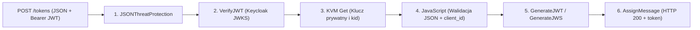

# Generator tokenów JWSID w Apigee Edge

Najlepszym i najbardziej „natywnym” podejściem na **Apigee Edge** jest zbudowanie **API Proxy bez backendu (*No Target Proxy*)**, w którym cały przepływ obsługują wbudowane polityki Apigee: **`VerifyJWT`** + **`KeyValueMapOperations`** + lekki **`JavaScript`** + **`GenerateJWT`** (lub **`GenerateJWS`**) + **`AssignMessage`**.

Dzięki temu unikasz pisania ciężkich *Java Calloutów*, korzystasz z wbudowanego cache’owania JWKS Keycloaka i natywnej kryptografii Apigee.

---

## Architektura przepływu (*No-Target Proxy*)

W `ProxyEndpoint` ustaw pustą regułę routingu `<RouteRule name="noroute"/>` (bez `TargetEndpoint`), a całą logikę umieść w `Request` danego Flow (np. `POST /tokens`):



---

## Krok po kroku — konfiguracja polityk

### 1. Weryfikacja tokena Bearer z Keycloaka (`VerifyJWT`)

Polityka sama pobierze i zcache’uje klucze publiczne z endpointu JWKS Keycloaka oraz zweryfikuje podpis, datę ważności (`exp`) i wystawcę (`iss`).

```xml
<VerifyJWT name="Verify-Keycloak-JWT">
    <Algorithm>RS256</Algorithm>
    <!-- WAŻNE: pomiń <Source>! Domyślnie Apigee sam czyta Authorization i ucina prefiks "Bearer " -->
    <PublicKey>
        <JWKS uri="https://keycloak.twoja-domena.pl/realms/TWOJ_REALM/protocol/openid-connect/certs"/>
    </PublicKey>
    <Issuer>https://keycloak.twoja-domena.pl/realms/TWOJ_REALM</Issuer>
</VerifyJWT>
```

> **Pułapka w Apigee Edge:** nie wpisuj `<Source>request.header.authorization</Source>` — wtedy Apigee **nie usunie** prefiksu `Bearer ` i weryfikacja się nie powiedzie. Brak tagu `<Source>` obsługuje `Authorization: Bearer <jwt>` automatycznie.

Po poprawnej weryfikacji Apigee udostępni claimy jako zmienne flow:
* `jwt.Verify-Keycloak-JWT.claim.client_id`
* `jwt.Verify-Keycloak-JWT.claim.azp` *(w Keycloaku identyfikator klienta jest najczęściej w `azp`, a przy Client Credentials także w `client_id`/`clientId`)*.

---

### 2. Pobranie klucza podpisującego z zaszyfrowanej KVM (`KeyValueMapOperations`)

Klucz prywatny (PEM) przechowuj w **Encrypted KVM** na poziomie środowiska (nie w kodzie proxy) i odczytuj go do zmiennej z prefiksem **`private.`**, dzięki czemu nie będzie widoczny w Trace/Debug:

```xml
<KeyValueMapOperations name="KVM-Get-JWSID-Keys" mapIdentifier="jwsid-signing-keys">
    <Scope>environment</Scope>
    <Get assignTo="private.jwsid.private_key">
        <Key>
            <Parameter>private_key_pem</Parameter>
        </Key>
    </Get>
    <Get assignTo="jwsid.kid">
        <Key>
            <Parameter>active_kid</Parameter>
        </Key>
    </Get>
</KeyValueMapOperations>
```

---

### 3. Walidacja JSON-a wejściowego i wstrzyknięcie `client_id` (`JavaScript`)

Polityka JS jest tu kluczowa ze względów bezpieczeństwa — gwarantuje, że klient w przesłanym JSON-ie **nie nadpisze** `client_id` ani claimów zarezerwowanych (`exp`, `iat`, `iss`, `nbf`, `jti`).

```javascript
// JS-Prepare-JWSID-Claims.js
var rawBody = context.getVariable("request.content");
var payload;

try {
    payload = JSON.parse(rawBody);
} catch (e) {
    context.setVariable("jwsid.error", "Niepoprawny format JSON w body żądania");
    throw new Error("Invalid JSON");
}

if (!payload || typeof payload !== "object" || Array.isArray(payload)) {
    context.setVariable("jwsid.error", "Body musi być obiektem JSON");
    throw new Error("JSON payload must be an object");
}

// 1. Odczyt client_id ze zweryfikowanego tokena Keycloaka
var clientId =
    context.getVariable("jwt.Verify-Keycloak-JWT.claim.client_id") ||
    context.getVariable("jwt.Verify-Keycloak-JWT.claim.azp");

if (!clientId) {
    context.setVariable("jwsid.error", "Brak claimu client_id/azp w tokenie Bearer");
    throw new Error("Missing client_id");
}

// 2. Usunięcie claimów zastrzeżonych (ochrona przed nadpisaniem przez klienta)
var reserved = ["iss", "iat", "exp", "nbf", "jti", "client_id"];
for (var i = 0; i < reserved.length; i++) {
    delete payload[reserved[i]];
}

// (Opcjonalnie: jeśli znasz zamkniętą listę pól z JSON-a, użyj whitelisty zamiast delete!)

// 3. Dodanie zaufanego client_id z tokena Bearer
payload.client_id = clientId;

// 4. Zapis jako JSON string dla polityki GenerateJWT
context.setVariable("jwsid.claims", JSON.stringify(payload));
```

---

### 4. Wygenerowanie tokena JWSID (`GenerateJWT` vs `GenerateJWS`)

W zależności od wymagań formatu **JWSID** masz dwie natywne polityki:

#### Wariant A: `GenerateJWT` (zalecany, gdy JWSID to standardowo podpisany JWT z `exp`, `iat`, `iss`, `jti`)
Atrybut `<AdditionalClaims ref="jwsid.claims"/>` automatycznie parsuje JSON ze zmiennej (zachowując typy: string, number, boolean, tablice, obiekty) i dokłada je jako claimy na głównym poziomie tokena:

```xml
<GenerateJWT name="Generate-JWSID">
    <Algorithm>RS256</Algorithm>
    <PrivateKey>
        <Value ref="private.jwsid.private_key"/>
        <Id ref="jwsid.kid"/>
    </PrivateKey>
    <Issuer>https://apigee.twoja-domena.pl</Issuer>
    <ExpiresIn>15m</ExpiresIn>
    <Id/> <!-- automatycznie generuje unikalny claim jti (UUID) -->
    <AdditionalClaims ref="jwsid.claims"/>
    <OutputVariable>jwsid.token</OutputVariable>
</GenerateJWT>
```

#### Wariant B: `GenerateJWS` (gdy specyfikacja JWSID wymaga własnego nagłówka `typ` innego niż `JWT` lub pełnej kontroli nad surowym payloadem)
W tym wariancie `iat`/`exp` (jeśli potrzebne) dopisujesz w JS do `payload`, a następnie podpisujesz cały JSON przez `GenerateJWS`:

```xml
<GenerateJWS name="Generate-JWSID-Raw">
    <Algorithm>RS256</Algorithm>
    <PrivateKey>
        <Value ref="private.jwsid.private_key"/>
        <Id ref="jwsid.kid"/>
    </PrivateKey>
    <AdditionalHeaders>
        <Claim name="typ">JWSID</Claim>
    </AdditionalHeaders>
    <Payload ref="jwsid.claims"/>
    <OutputVariable>jwsid.token</OutputVariable>
</GenerateJWS>
```

---

### 5. Zwrócenie odpowiedzi (`AssignMessage`)

```xml
<AssignMessage name="AM-Return-JWSID">
    <Set>
        <Headers>
            <Header name="Cache-Control">no-store</Header>
            <Header name="Pragma">no-cache</Header>
        </Headers>
        <Payload contentType="application/json">{"token": "{jwsid.token}"}</Payload>
        <StatusCode>200</StatusCode>
    </Set>
    <IgnoreUnresolvedVariables>true</IgnoreUnresolvedVariables>
    <AssignTo createNew="false" transport="http" type="response"/>
</AssignMessage>
```

---

## Najważniejsze dobre praktyki

1. **Algorytm asymetryczny (`RS256` / `PS256` / `ES256`) zamiast `HS256`:** dzięki temu konsumenci tokena JWSID potrzebują tylko klucza publicznego do weryfikacji i nie mogą sami podpisywać fałszywych tokenów. Warto od razu wystawić w tym samym proxy endpoint `GET /.well-known/jwks.json` zwracający klucz publiczny (z `kid`), co ułatwi rotację kluczy.
2. **Biała lista pól wejściowych (*Allowlist*):** jeśli kontrakt wejściowego JSON-a jest znany, w skrypcie JS przepisuj tylko dozwolone pola zamiast całego obiektu — zapobiegnie to wstrzykiwaniu nieoczekiwanych claimów i puchnięciu rozmiaru tokena.
3. **`JSONThreatProtection` przed `JavaScript`:** ogranicz maksymalną głębokość i rozmiar JSON-a (np. 16–32 KB), żeby chronić Message Processory przed atakami DoS na parser JSON.
4. **`FaultRules`:** dodaj osobne reguły błędów zwracające `401 Unauthorized` (gdy `Verify-Keycloak-JWT` zawiedzie) oraz `400 Bad Request` (gdy walidacja JSON w JS rzuci błąd), aby nie ujawniać wewnętrznych komunikatów Apigee.
5. **Dostęp sieciowy MP → Keycloak:** w Apigee Edge Private Cloud upewnij się, że Message Processory mają dostęp sieciowy do URL-a JWKS Keycloaka oraz ufają jego certyfikatowi TLS (Truststore / certyfikat CA w JVM, jeśli Keycloak ma certyfikat prywatny).
